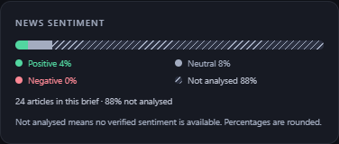

# 뉴스 감성 비율·분석 범위 표시 수정

사용자가 제보한 브리프에는 긍정 4%, 중립 8%, 부정 0%, 미분석 88%가 저장돼 있었다. 화면은 unknown 항목을 제외해 차트가 12%만 채워지고 24개 전체 기사가 분석된 것처럼 보였다.

미분석을 별도의 사선 무늬 구간과 범례로 표시한다. 기준은 이 브리프에 포함된 기사 전체이며, 화면에서 미분석 비중을 명시한다. 현재 브리프의 저장 값은 유지한다. 독립 반올림으로 99%/101%가 되는 경우에는 최대 나머지 방식으로 표시 합계를 100%로 맞춘다. 빈 표본은 분포를 만들어내지 않는다.

이후 생성되는 브리프에는 감성별 정확한 개수를 JSON에 함께 저장한다. 원문을 검증한 기사만 감성 분석 완료로 집계하고 나머지는 미분석으로 둔다. 정확한 개수가 있는 새 기록은 분석/미분석 건수를 표시한다. 기존 퍼센트에서 과거 개수를 추정하거나 기사 감성을 재작성하지 않는다. 기존 저장 형식과 호환되며 DB 스키마 변경은 없다. 'today' 대신 해당 브리프의 표본임을 명시한다.

실시간 뉴스 감성 위젯에도 같은 합계 보정 규칙을 적용했다. 방향 판정은 반올림된 퍼센트가 아닌 실제 개수로 계산해 균형 표본이 반올림 때문에 bullish로 바뀌지 않게 했다.

검증: TypeScript/TSX 188개, Python 158+15개, ESLint, 타입 검사 및 프로덕션 빌드 통과. 실제 기존 브리프 데이터로 데스크톱/모바일 × 밝음/어두움 4개 조합에서 [4,8,0,88], 합계 100, 브라우저 오류/가로 넘침/차트의 자동 접근성 위반 0건을 확인했다. 기존 기사·브리프 데이터를 수정하거나 새 AI 생성을 실행하지 않았다.

